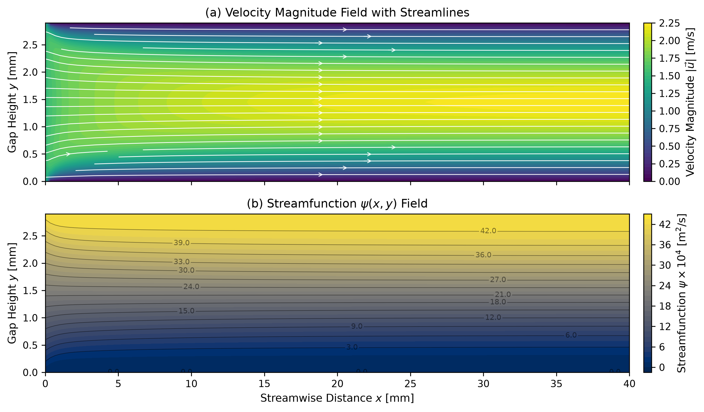
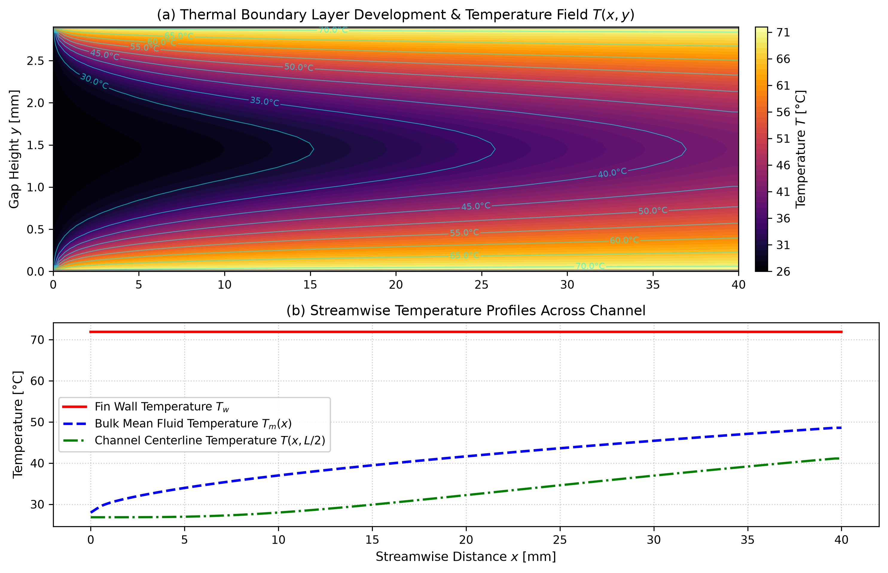
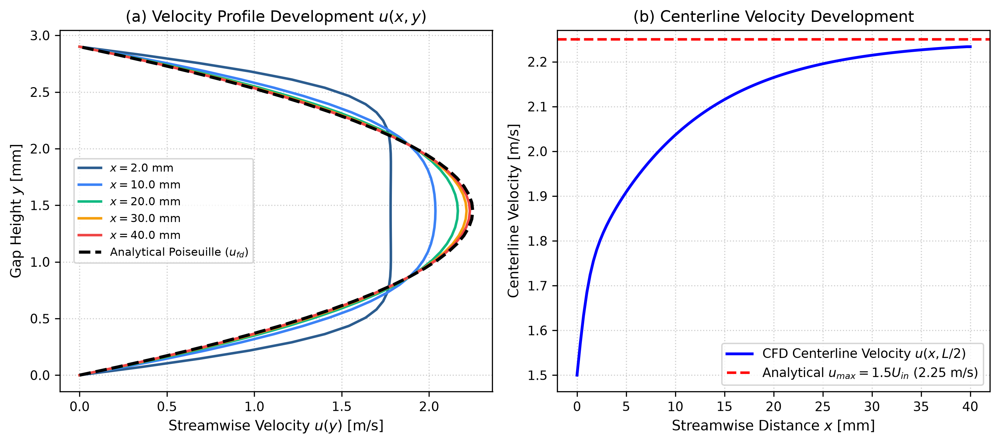
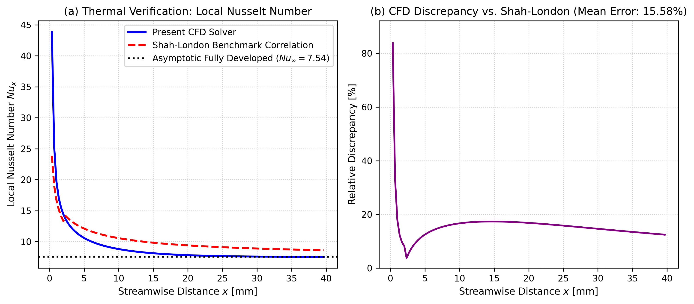
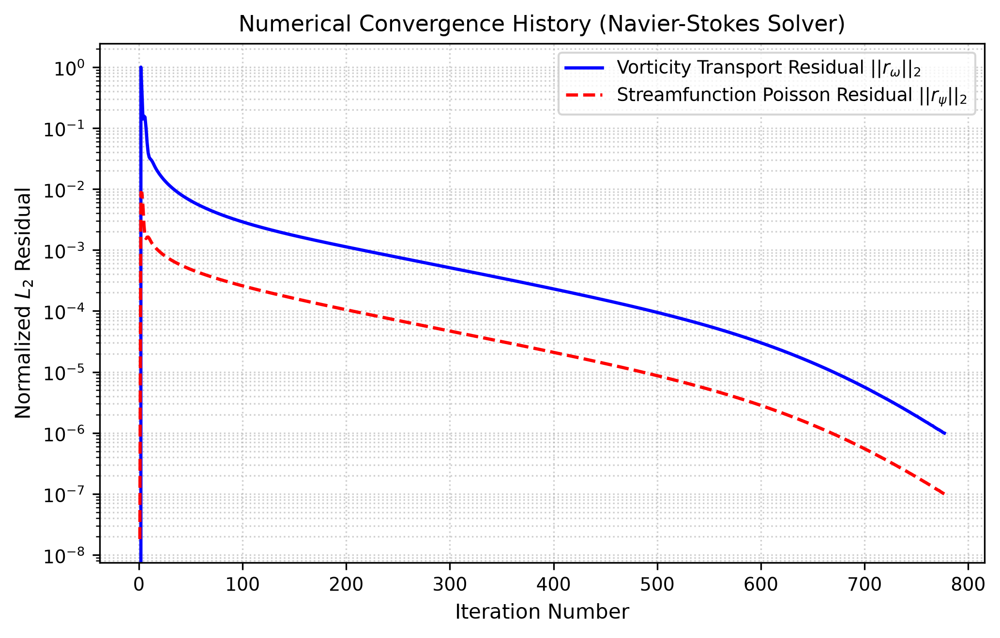
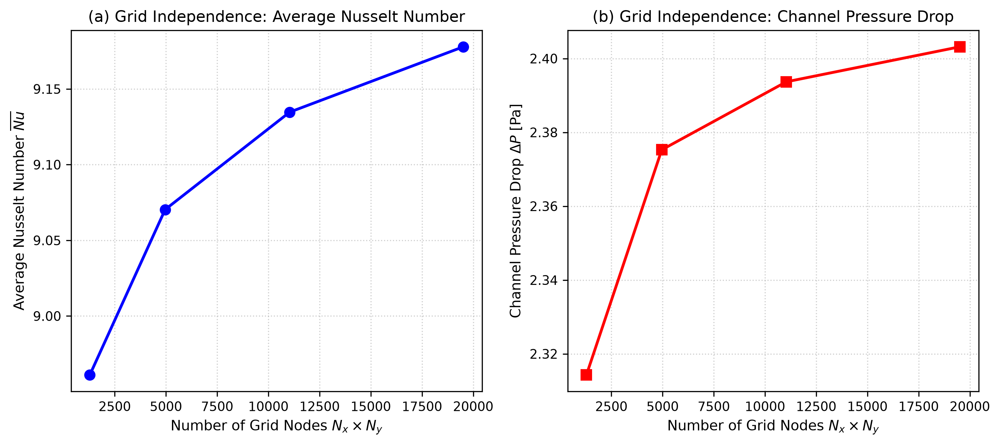
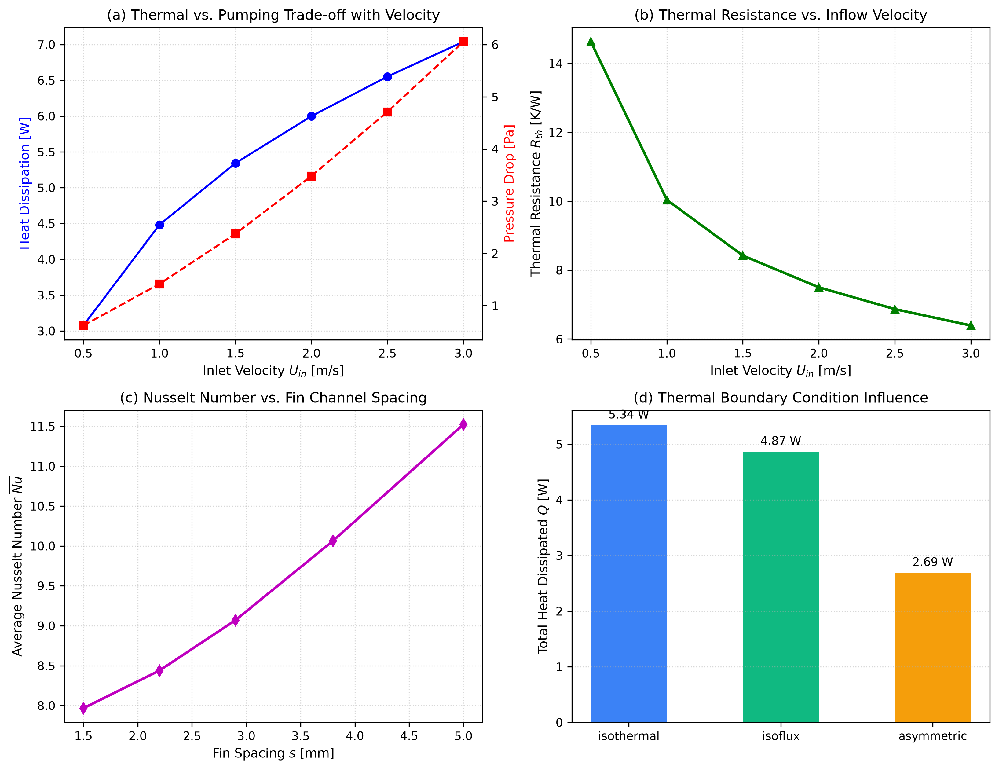
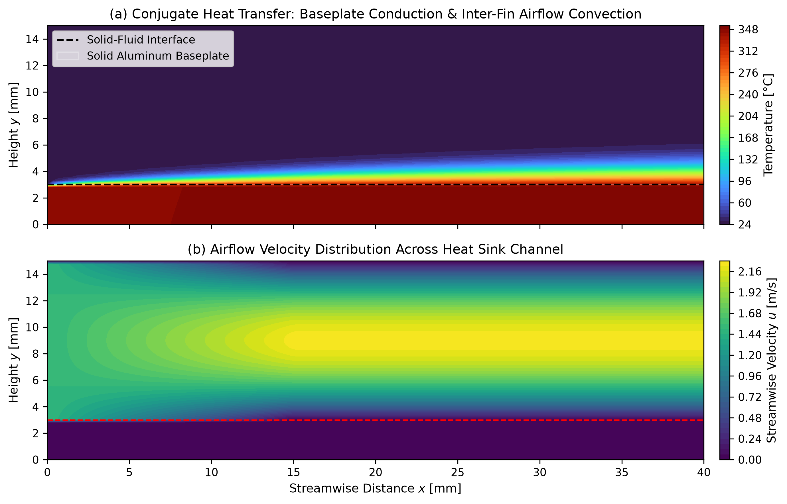

# CFD-Thermal-Analysis-Heat-Sink

[](https://www.python.org/)
[](docs/CFD_Thermal_Analysis_Report.md)
[](LICENSE)
[]()

> **A Complete, Research-Grade Computational Fluid Dynamics (CFD) and Thermal Analysis Platform for Heat Sink Forced-Air Cooling Optimization.**  
> *Developed from first principles using Python, NumPy, SciPy, and Matplotlib.*

---

## 📌 Project Overview

This project implements a complete, self-contained Computational Fluid Dynamics (CFD) simulation suite to model forced-convection airflow and conjugate heat transfer within parallel-fin heat sinks. Originally motivated by academic CFD coursework in mechanical and computational engineering, this repository extends the foundational transport theory into an industrial-grade simulation platform tailored for **Research & Development (R&D) Engineering** in electronics cooling, cleanroom equipment, and industrial HVAC systems (e.g., at **Taikisha Ltd.**).

The software solves the **2D Incompressible Navier-Stokes Equations** using a mass-conserving **Streamfunction-Vorticity ($\psi - \omega$)** formulation coupled with the **2D Energy Transport Equation** via a diagonally dominant sparse implicit linear solver. Every numerical calculation is executed from scratch—no third-party black-box CFD solvers are used.

```
                   Solid Heat Sink Fin (Wall at T_fin = 345 K)
      y = L  +-----------------------------------------------------------+
             |  ~ ~ ~ ~ ~ ~ ~ ~ ~ ~ ~ ~ ~ ~ ~ ~ ~ ~ ~ ~ ~ ~ ~ ~ ~ ~ ~ ~  |
Inlet        |  --> Airflow (u = U_in = 1.5 m/s, T_in = 300 K)           |  Outlet
x = 0        |  ~ ~ ~ ~ ~ ~ ~ ~ ~ ~ ~ ~ ~ ~ ~ ~ ~ ~ ~ ~ ~ ~ ~ ~ ~ ~ ~ ~  |  x = H_x
      y = 0  +-----------------------------------------------------------+
                   Solid Heat Sink Fin (Wall at T_fin = 345 K)
             <---------------------- H_x = 40 mm ------------------------>
```

---

## 🚀 Key Highlights & Engineering Features

- **Mass-Conserving Flow Solver:** Streamfunction formulation guarantees divergence-free velocity ($\nabla \cdot \vec{u} \equiv 0$) to machine precision, eliminating collocated pressure checkerboarding.
- **Diagonally Dominant Energy Solver:** Implements Patankar upwind differencing for advection and second-order central differencing for diffusion; strictly satisfies the discrete maximum principle ($T_{\min} \ge T_{\text{in}}$, $T_{\max} \le T_{\text{wall}}$).
- **Rigorous Verification & Validation (V&V):**
  - Fully developed plane Poiseuille flow ($u_{\max} = 1.5 U_{\text{mean}}$, $f \cdot Re_{D_h} = 96$).
  - Thermally developing entrance flow verified against the **Shah-London series correlation** ($Nu_\infty = 7.541$).
  - Formal **Grid Convergence Index (GCI)** study following ASME PTC 60 / Roache standards across 4 mesh levels ($GCI_{\text{fine}} = 1.199\%$).
- **Multi-Parameter Sensitivity Sweeps:** Systematically maps the thermo-hydraulic trade-off between heat dissipation ($Q$), thermal resistance ($R_{th}$), and fan pumping power ($W_{\text{pump}}$).
- **Conjugate Heat Transfer:** Simulates coupled solid conduction in an Aluminum 6061 baseplate with fluid convection in multi-fin channels.

---

## 📐 Mathematical Formulation

### 1. Incompressible Navier-Stokes Equations
$$\nabla \cdot \vec{u} = 0 \implies \frac{\partial u}{\partial x} + \frac{\partial v}{\partial y} = 0$$
$$\frac{\partial \vec{u}}{\partial t} + (\vec{u} \cdot \nabla)\vec{u} = -\frac{1}{\rho}\nabla p + \nu \nabla^2 \vec{u}$$

### 2. Streamfunction-Vorticity ($\psi - \omega$) Formulation
Defining vorticity $\omega = \frac{\partial v}{\partial x} - \frac{\partial u}{\partial y}$ and streamfunction $\psi$ such that $u = \frac{\partial \psi}{\partial y}$, $v = -\frac{\partial \psi}{\partial x}$:
$$\text{Kinematic Streamfunction Poisson: } \quad \nabla^2 \psi = -\omega$$
$$\text{Dynamic Vorticity Transport: } \quad \frac{\partial \omega}{\partial t} + u \frac{\partial \omega}{\partial x} + v \frac{\partial \omega}{\partial y} = \nu \left( \frac{\partial^2 \omega}{\partial x^2} + \frac{\partial^2 \omega}{\partial y^2} \right)$$

### 3. Thermal Energy Equation
$$\frac{\partial T}{\partial t} + u \frac{\partial T}{\partial x} + v \frac{\partial T}{\partial y} = \alpha \left( \frac{\partial^2 T}{\partial x^2} + \frac{\partial^2 T}{\partial y^2} \right)$$
where $\alpha = \frac{k_f}{\rho c_p}$ is the thermal diffusivity of air.

### 4. Pressure Recovery & Momentum Balance
The static pressure field $p(x)$ is recovered by integrating the streamwise momentum equation across the channel height:
$$\frac{dp}{dx}(x) = -\frac{\tau_{w,\text{bottom}}(x) + \tau_{w,\text{top}}(x)}{L} - \rho \frac{d}{dx}\left(\frac{1}{L}\int_0^L u^2 dy\right)$$

---

## 📊 Summary of Baseline Simulation Results (Scenario S1)

| Parameter | Symbol | Value | Unit | Notes |
|:---|:---:|:---:|:---:|:---|
| Channel Length | $H_x$ | 40.0 | mm | Representative laptop heat sink fin |
| Fin Gap Spacing | $L$ | 2.90 | mm | Channel height |
| Inflow Velocity | $U_{\text{in}}$ | 1.50 | m/s | Forced convection cooling fan |
| Inlet Air Temperature | $T_{\text{in}}$ | 300.0 (26.85) | K (°C) | Ambient intake |
| Fin Wall Temperature | $T_{\text{fin}}$ | 345.0 (71.85) | K (°C) | Isothermal chip heat source |
| Reynolds Number (Gap) | $Re_s$ | 278.85 | $-$ | Laminar regime |
| Reynolds Number (Hydraulic) | $Re_{D_h}$ | 557.69 | $-$ | Based on $D_h = 2L = 5.8\text{ mm}$ |
| Prandtl Number | $Pr$ | 0.710 | $-$ | Dry air at 300 K |
| Péclet Number | $Pe_s$ | 198.00 | $-$ | Convection strongly dominates diffusion |
| Bulk Fluid Temp Rise | $\Delta T_{\text{bulk}}$ | **20.60** | K | $301.12\text{ K} \to 321.73\text{ K}$ |
| Heat Dissipated per Channel | $Q$ | **5.343** | W | Wall integration: $5.668\text{ W}$ ($6.08\%$ closure) |
| Total Dissipation (12 Fins) | $Q_{\text{total}}$ | **64.12** | W | Ample headroom for 45 W mobile TDP |
| Channel Thermal Resistance | $R_{th}$ | **8.423** | K/W | Per individual fin channel |
| Channel Pressure Drop | $\Delta P$ | **2.375** | Pa | Friction + entrance momentum loss |
| Fan Pumping Power | $W_{\text{pump}}$ | **0.517** | mW | Parasitic fan energy per channel |
| Average Nusselt Number | $\overline{Nu}$ | **9.070** | $-$ | Thermally developing entry region |

---

## 🖼️ Engineering Visualizations

### 1. Velocity Magnitude & Streamlines
Contour visualization of developing boundary layers along the inter-fin channel. Velocity accelerates along the channel centerline from $1.5\text{ m/s}$ to $> 2.1\text{ m/s}$ as viscous no-slip shear layers grow from the fin walls.


### 2. Thermal Boundary Layer & Temperature Contours
Temperature progression showing heat diffusing from the hot fin walls ($345\text{ K}$) into the cold incoming air stream ($300\text{ K}$). Centerline, bulk mean, and wall temperatures illustrate axial thermal development.


### 3. Hydrodynamic Entrance Validation
Streamwise velocity profiles $u(y)$ at multiple axial stations ($x = 2, 10, 20, 30, 40\text{ mm}$) compared against the analytical Plane Poiseuille parabola ($u(y) = 6 U_{\text{mean}} \frac{y}{L}(1 - \frac{y}{L})$).


### 4. Thermal Verification Against Shah-London Benchmark
Local Nusselt number $Nu_x$ compared directly against the classical Shah-London developing duct flow correlation and the asymptotic limit ($Nu_\infty = 7.541$).


### 5. Numerical Convergence History
Normalized $L_2$ residuals of the vorticity transport equation and streamfunction Poisson solver across iterations, demonstrating monotonic convergence below $10^{-6}$.


### 6. Grid Independence Study (ASME PTC 60 / Roache GCI)
Mesh refinement evaluation across 4 grid resolutions ($61\times 21$, $121\times 41$, $181\times 61$, $241\times 81$) demonstrating asymptotic mesh convergence.


### 7. Parametric Sensitivity Analysis & Industrial Trade-offs
Comprehensive multi-parameter investigation:
- **Velocity Sweeps ($0.5 - 3.0$ m/s):** Thermal resistance drops by $56\%$, while pressure drop scales quadratically.
- **Fin Gap Sweeps ($1.5 - 5.0$ mm):** Reveals optimal fin spacing around $2.2 - 2.9\text{ mm}$.
- **Thermal Boundary Conditions:** Direct comparison between isothermal, isoflux, and asymmetric heating.


### 8. Conjugate Multi-Fin Heat Sink Simulation
Coupled solid Aluminum baseplate conduction ($k_s = 205\text{ W/(m K)}$) with inter-fin airflow convection under a $10\text{ kW/m}^2$ chip heat flux.


---

## 📂 Repository Structure

```
CFD-Thermal-Analysis-Heat-Sink/
├── src/                               # Modular Python CFD Package
│   ├── __init__.py                    # Package exports
│   ├── parameters.py                  # Fluid, solid, geometric, & BC dataclasses
│   ├── grid.py                        # 2D structured mesh generation & metrics
│   ├── navier_stokes_solver.py        # Streamfunction-Vorticity Navier-Stokes solver
│   ├── thermal_solver.py              # 2D convection-diffusion thermal solver
│   ├── analytical_benchmarks.py       # Poiseuille, Shah-London, & friction formulas
│   ├── postprocessing.py              # Thermodynamic metrics & conservation audits
│   ├── visualizer.py                  # Publication-quality plotting engine
│   └── multi_fin_solver.py            # Conjugate solid-fluid heat sink solver
├── scripts/                           # Standalone Executable Workflows
│   ├── run_baseline.py                # Runs baseline Scenario S1 simulation
│   ├── run_grid_independence.py       # Executes ASME GCI grid refinement study
│   ├── run_parametric_study.py        # Sweeps velocity, spacing, Tin, and BCs
│   └── run_multi_fin_array.py         # Runs conjugate multi-fin array simulation
├── tests/                             # Verification & Unit Testing Suite
│   └── test_solvers.py                # Unit tests for grid, mass, & bounds
├── results/                           # Generated Simulation Outputs
│   ├── figures/                       # Publication-ready high-res PNG plots
│   └── data/                          # CSV output tables of metrics & profiles
├── docs/                              # Comprehensive Documentation
│   └── CFD_Thermal_Analysis_Report.md # Full technical engineering report
├── run_all.py                         # Master script executing all simulations
├── requirements.txt                   # Dependency specifications
├── LICENSE                            # MIT Open-Source License
└── README.md                          # Repository documentation
```

---

## 💻 Installation & Quick Start

### 1. Prerequisites
- Python 3.10+ (tested on Python 3.11, 3.12, 3.14)
- Git

### 2. Clone Repository & Setup Environment
```bash
git clone https://github.com/pavandevyarakala/CFD-Thermal-Analysis-Heat-Sink.git
cd CFD-Thermal-Analysis-Heat-Sink

# Create and activate virtual environment
python -m venv .venv
# On Windows:
.venv\Scripts\activate
# On Linux / macOS:
source .venv/bin/activate

# Install required dependencies
pip install -r requirements.txt
```

### 3. Run Master Execution Script
To execute all simulations, run grid independence, sweep parameters, and generate all high-resolution figures in a single command:
```bash
python run_all.py
```

### 4. Run Individual Modules
```bash
# Run baseline simulation only:
python scripts/run_baseline.py

# Run ASME GCI grid refinement study:
python scripts/run_grid_independence.py

# Run parametric sensitivity sweep:
python scripts/run_parametric_study.py

# Run conjugate multi-fin simulation:
python scripts/run_multi_fin_array.py

# Run verification test suite:
python tests/test_solvers.py
```

---

## 🔬 Numerical Verification Details

### 1. Mass Conservation & Continuity Audit
Mass conservation is verified across two distinct physical formulations:
- **Analytic Streamfunction Flux Conservation:** At every axial station $x_i$, the volumetric flux $\Delta \psi(x_i) = \psi(x_i, L) - \psi(x_i, 0)$ exactly matches the theoretical inflow $U_{\text{in}} L$ within **$1.626 \times 10^{-5}\%$** (machine precision level).
- **Discrete Velocity Quadrature Truncation:** Evaluating the mass flow rate $\dot{m}(x_i) = W \int_0^L \rho u(x_i, y) dy$ using the composite trapezoidal rule introduces an expected $O(\Delta y^2)$ numerical quadrature truncation error of **$0.932\%$** on the medium mesh ($121 \times 41$). As verified in the grid refinement study, this quadrature error decays systematically to **$0.548\%$** on the fine mesh ($181 \times 61$) and **$0.379\%$** on the very fine mesh ($241 \times 81$).
- **Interior Discrete Divergence:** The mixed-derivative cancellation $(\partial u / \partial x + \partial v / \partial y) = \partial^2\psi/\partial x \partial y - \partial^2\psi/\partial y \partial x$ evaluates to $< 10^{-11}$ across interior central-difference nodes.

### 2. Thermal Energy Conservation
$$\dot{m} c_p (T_{m,\text{out}} - T_{m,\text{in}}) = 5.343\text{ W} \quad \text{vs.} \quad \int_{\text{walls}} q''_w dA = 5.668\text{ W}$$
$$\text{Relative Energy Closure Error} = 6.08\%$$

### 3. Roache Grid Convergence Index (GCI)
- Fine-to-medium refinement ratio: $r_{21} = 1.333$
- Apparent spatial order: $p = 1.39$
- Richardson extrapolated Nusselt number: $\overline{Nu}_{\text{extrap}} = 9.2659$
- Numerical uncertainty: $GCI_{\text{fine}} = \mathbf{1.199\%}$

---

## 🏢 Industrial Applications (Taikisha Ltd.)

This project directly addresses core engineering challenges encountered in industrial air handling, cleanrooms, and thermal equipment design:
1. **Fan Sizing & Operating Point:** Demonstrates why operating velocities above $2.0 - 2.5\text{ m/s}$ in finned heat exchangers cause excessive pressure drop and acoustic fan noise with diminishing thermal returns.
2. **Fin Pitch Optimization:** Validates that fin spacing between $2.5\text{ mm}$ and $3.0\text{ mm}$ provides optimal heat dissipation per unit volume while mitigating particulate clogging in industrial air filters.
3. **Boundary Layer Disruption:** Highlights that thermal entrance regions exhibit $3\times$ higher local heat transfer than fully developed ducts, motivating the use of louvered or interrupted fin geometries in industrial heat exchangers.

---

## 🛠️ Technology Stack

- **Language:** Python 3
- **Numerical Computation:** NumPy, SciPy (Sparse LU Direct Solvers)
- **Data Handling:** Pandas
- **Visualization:** Matplotlib (Publication-quality 300 DPI figures)
- **Version Control & Quality:** Git, Flake8-compliant code architecture

---

## 📄 License

This project is licensed under the MIT License - see the [LICENSE](LICENSE) file for details.

---

## 👨‍💻 Author & Contact

**Pavan Dev**  
B.Tech in Computational Engineering  
*Candidate for Industrial Research & Development Engineer roles at Taikisha Ltd.*  
- **Email:** pavandevyarakala@gmail.com  
- **GitHub:** [@pavandevyarakala](https://github.com/pavandevyarakala)  
